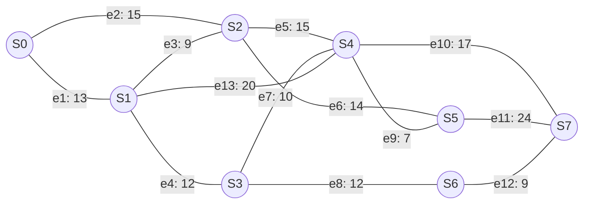

# Ponderada — Felipe Caiafa

Arquivos:
- [`main.py`](main.py) — TAD Grafo + Dijkstra + Prim (rodar com `python main.py`)
- [`saida.txt`](saida.txt) — saída real do terminal

---

## Etapa 1 — Modelagem formal e matriz de pesos

### 1.1 Dígitos do RA e destino

| D1 | D2 | D3 | D4 | D5 | D6 |
|---|---|---|---|---|---|
| 5 | 1 | 0 | 1 | 0 | 8 |

D6 = 8 é **par** → **destino = S7**. Origem = S0.

### 1.2 Pesos calculados

| Aresta | Ramal | Fórmula | Cálculo | w (km) |
|---|---|---|---|---|
| e1 | (S0, S1) | 10 + (D6 mod 5) | 10 + (8 mod 5) = 10 + 3 | **13** |
| e2 | (S0, S2) | 15 + (D5 mod 7) | 15 + (0 mod 7) = 15 + 0 | **15** |
| e3 | (S1, S2) | 8 + (D4 mod 4) | 8 + (1 mod 4) = 8 + 1 | **9** |
| e4 | (S1, S3) | 12 + (D3 mod 6) | 12 + (0 mod 6) = 12 + 0 | **12** |
| e5 | (S2, S4) | 14 + (D2 mod 5) | 14 + (1 mod 5) = 14 + 1 | **15** |
| e6 | (S2, S5) | 9 + (D1 mod 6) | 9 + (5 mod 6) = 9 + 5 | **14** |
| e7 | (S3, S4) | 7 + ((D5+D6) mod 5) | 7 + (8 mod 5) = 7 + 3 | **10** |
| e8 | (S3, S6) | 11 + ((D4+D5) mod 6) | 11 + (1 mod 6) = 11 + 1 | **12** |
| e9 | (S4, S5) | 6 + ((D3+D4) mod 4) | 6 + (1 mod 4) = 6 + 1 | **7** |
| e10 | (S4, S7) | 16 + ((D2+D3) mod 7) | 16 + (1 mod 7) = 16 + 1 | **17** |
| e11 | (S5, S7) | 18 + ((D1+D2) mod 8) | 18 + (6 mod 8) = 18 + 6 | **24** |
| e12 | (S6, S7) | 9 + ((D5+D1) mod 5) | 9 + (5 mod 5) = 9 + 0 | **9** |
| e13 | (S1, S4) | 20 + (D6 mod 4) | 20 + (8 mod 4) = 20 + 0 | **20** |

### 1.3 Diagrama topológico



### 1.4 Matriz de pesos 8×8 (— = NULO)

|    | S0 | S1 | S2 | S3 | S4 | S5 | S6 | S7 |
|----|----|----|----|----|----|----|----|----|
| **S0** | — | 13 | 15 | — | — | — | — | — |
| **S1** | 13 | — | 9 | 12 | 20 | — | — | — |
| **S2** | 15 | 9 | — | — | 15 | 14 | — | — |
| **S3** | — | 12 | — | — | 10 | — | 12 | — |
| **S4** | — | 20 | 15 | 10 | — | 7 | — | 17 |
| **S5** | — | — | 14 | — | 7 | — | — | 24 |
| **S6** | — | — | — | 12 | — | — | — | 9 |
| **S7** | — | — | — | — | 17 | 24 | 9 | — |

**Simetria:** M[i][j] = M[j][i] para todo par (o grafo é não orientado, cada ramal é gravado nas duas posições). **Esparsidade:** 26 das 64 células têm peso (13 arestas × 2), as outras 38 são NULO — inclusive a diagonal, pois não há laço.

---

## Etapa 2 — Teste de mesa de Dijkstra (origem S0, destino S7)

Valores entre colchetes = vértice já fechado. Desempate: menor índice.

| Iter. | u | L[u] | L[S0] | L[S1] | L[S2] | L[S3] | L[S4] | L[S5] | L[S6] | L[S7] | Antecessores atualizados |
|---|---|---|---|---|---|---|---|---|---|---|---|
| Inic. | — | — | 0 | ∞ | ∞ | ∞ | ∞ | ∞ | ∞ | ∞ | Inicialização na origem S0 |
| 1 | S0 | 0 | [0] | 13 | 15 | ∞ | ∞ | ∞ | ∞ | ∞ | Ant[S1] = S0 (0+13), Ant[S2] = S0 (0+15) |
| 2 | S1 | 13 | [0] | [13] | 15 | 25 | 33 | ∞ | ∞ | ∞ | Ant[S3] = S1 (13+12), Ant[S4] = S1 (13+20). S2: 13+9 = 22 > 15, não muda |
| 3 | S2 | 15 | [0] | [13] | [15] | 25 | 30 | 29 | ∞ | ∞ | Ant[S4] = S2 (15+15 = 30 < 33), Ant[S5] = S2 (15+14) |
| 4 | S3 | 25 | [0] | [13] | [15] | [25] | 30 | 29 | 37 | ∞ | Ant[S6] = S3 (25+12). S4: 25+10 = 35 > 30, não muda |
| 5 | S5 | 29 | [0] | [13] | [15] | [25] | 30 | [29] | 37 | 53 | Ant[S7] = S5 (29+24). S4: 29+7 = 36 > 30, não muda |
| 6 | S4 | 30 | [0] | [13] | [15] | [25] | [30] | [29] | 37 | 47 | Ant[S7] = S4 (30+17 = 47 < 53) |
| 7 | S6 | 37 | [0] | [13] | [15] | [25] | [30] | [29] | [37] | 46 | Ant[S7] = S6 (37+9 = 46 < 47) |
| 8 | S7 | 46 | [0] | [13] | [15] | [25] | [30] | [29] | [37] | [46] | Destino fechado — fim |

Reconstrução pelos antecessores: S7 ← S6 ← S3 ← S1 ← S0 → **S0 → S1 → S3 → S6 → S7 = 46 km**.

Observação: S7 teve o antecessor trocado duas vezes (S5 → S4 → S6), o que mostra a importância de só considerar a distância definitiva quando o vértice é fechado.

---

## Etapa 3 — Implementação e validação

### 3.1 Código

Tudo está em [`main.py`](main.py), comentado passo a passo:

- **Configuração no topo**: `RA`, `ORIGEM` e `RAMAL_CONTINGENCIA`. São as únicas linhas que precisam mudar se o enunciado mudar (ver o Guia de adaptação no final).
- **TAD `Grafo`**: matriz de adjacência 8×8 com `None` como sentinela NULO. Operações: `adicionar_aresta` (grava M[i][j] e M[j][i] e **rejeita peso negativo** com `ValueError`), `remover_aresta`, `peso`, `vizinhos`, `eh_simetrica`, `copia`, `imprimir_matriz`.
- **`dijkstra(g, origem, destino)`**: escolhe o aberto de menor `(L[v], índice)` — a regra de desempate do enunciado. Guarda um *trace* de cada iteração para imprimir a mesma tabela da Etapa 2. Ausência de aresta = `None` (ignorada); distância desconhecida = `float("inf")`.
- **`prim(g)`**: MST a partir de S0, mesma lógica de "chave mínima + menor índice".
- **`pesos_do_ra(ra)`**: aplica as 13 fórmulas — basta trocar a constante `RA` no topo.
- **`escolher_destino(D6)`**: D6 par → S7, D6 ímpar → S6.

### 3.2 Evidência de console

Saída completa em [`saida.txt`](saida.txt). Trecho principal:

```
RA = 510108  ->  D1=5, D2=1, D3=0, D4=1, D5=0, D6=8
Origem = S0 | Destino = S7 (D6 = 8 é par)

== Matriz de adjacência 8x8 (— = NULO) ==
          S0    S1    S2    S3    S4    S5    S6    S7
    S0     —    13    15     —     —     —     —     —
    S1    13     —     9    12    20     —     —     —
    S2    15     9     —     —    15    14     —     —
    S3     —    12     —     —    10     —    12     —
    S4     —    20    15    10     —     7     —    17
    S5     —     —    14     —     7     —     —    24
    S6     —     —     —    12     —     —     —     9
    S7     —     —     —     —    17    24     9     —
Simétrica? True | Todos os pesos >= 0? True

Custo mínimo S0 -> S7: 46 km
Rota ótima: S0 -> S1 -> S3 -> S6 -> S7
Ordem de fechamento: S0, S1, S2, S3, S5, S4, S6, S7
```

> Print do terminal: `print_terminal.png` *(adicionar)*

### 3.3 Confronto código × mesa

| Item | Teste de mesa | Código | Confere? |
|---|---|---|---|
| Custo S0 → S7 | 46 km | 46 km | Sim |
| Rota | S0 → S1 → S3 → S6 → S7 | S0 → S1 → S3 → S6 → S7 | Sim |
| Ordem de fechamento | S0, S1, S2, S3, S5, S4, S6, S7 | S0, S1, S2, S3, S5, S4, S6, S7 | Sim |
| L[v] e Ant[v] por iteração | tabela da Etapa 2 | tabela impressa pelo código (idêntica, linha a linha) | Sim |

Pontos críticos verificados: (1) na iteração 5 o código fecha **S5 (29) antes de S4 (30)**, igual à mesa — a ordem de fechamento não segue o índice, e sim a distância; (2) as três atualizações sucessivas de Ant[S7] (S5 → S4 → S6) aparecem nas duas versões; (3) não houve empate de L entre abertos neste RA, então a regra de desempate não chegou a ser acionada, mas está implementada (`key=(L[v], v)`).

### 3.4 Auditoria do uso de LLM

O código foi escrito com auxílio de LLM (Claude). Auditoria feita:
- Conferi as 13 fórmulas da função `pesos_do_ra` contra a tabela do enunciado e refiz os cálculos à mão (Etapa 1.2).
- Refiz o Dijkstra à mão (Etapa 2) antes de comparar com a saída — os valores bateram célula por célula.
- Verifiquei que o desempate usa o índice como segundo critério (`min(..., key=lambda v: (L[v], v))`), e não a ordem de inserção.
- Verifiquei que o código **não relaxa vértices já fechados** e que remover a aresta e5 limpa M[2][4] **e** M[4][2].
- Confirmei a MST também pelo método de Kruskal manualmente (mesmo custo de 72 km).

---

## Etapa 4 — Questionário

### Questão 1 — Rota e custo ótimo

- **Custo mínimo:** **46 km**
- **Rota:** **S0 → S1 → S3 → S6 → S7** (13 + 12 + 12 + 9 = 46)
- **Ordem de fechamento:** S0, S1, S2, S3, S5, S4, S6, S7

### Questão 2 — Contingência no ramal e5 = (S2, S4)

Removendo e5 (w5 = ∞) e rodando o Dijkstra de novo (tabela completa em `saida.txt`):

| Iter. | u | L[u] | L[S0] | L[S1] | L[S2] | L[S3] | L[S4] | L[S5] | L[S6] | L[S7] | Antecessores atualizados |
|---|---|---|---|---|---|---|---|---|---|---|---|
| Inic. | — | — | 0 | ∞ | ∞ | ∞ | ∞ | ∞ | ∞ | ∞ | — |
| 1 | S0 | 0 | [0] | 13 | 15 | ∞ | ∞ | ∞ | ∞ | ∞ | Ant[S1] = S0, Ant[S2] = S0 |
| 2 | S1 | 13 | [0] | [13] | 15 | 25 | 33 | ∞ | ∞ | ∞ | Ant[S3] = S1, Ant[S4] = S1 |
| 3 | S2 | 15 | [0] | [13] | [15] | 25 | 33 | 29 | ∞ | ∞ | Ant[S5] = S2 (S4 não melhora: e5 caiu) |
| 4 | S3 | 25 | [0] | [13] | [15] | [25] | 33 | 29 | 37 | ∞ | Ant[S6] = S3 |
| 5 | S5 | 29 | [0] | [13] | [15] | [25] | 33 | [29] | 37 | 53 | Ant[S7] = S5 |
| 6 | S4 | 33 | [0] | [13] | [15] | [25] | [33] | [29] | 37 | 50 | Ant[S7] = S4 |
| 7 | S6 | 37 | [0] | [13] | [15] | [25] | [33] | [29] | [37] | 46 | Ant[S7] = S6 |
| 8 | S7 | 46 | [0] | [13] | [15] | [25] | [33] | [29] | [37] | [46] | fim |

- **Nova rota:** S0 → S1 → S3 → S6 → S7 (a mesma)
- **Novo custo:** 46 km
- **Acréscimo:** **0 km (0,00 %)**

**Por quê?** O ramal e5 não faz parte da rota ótima até S7 — ele só era usado para chegar em **S4** (S0 → S2 → S4 = 30 km). Sem ele, S4 passa a custar 33 km (via S1), e o caminho alternativo pelo S4 até S7 piora de 47 para 50 km, mas continua perdendo para o corredor norte S1–S3–S6 (46 km). Ou seja, para o meu RA a rota de emergência até S7 é **resiliente** à queda de e5; o impacto fica restrito ao atendimento de S4 (+3 km, +10 %).

### Questão 3 — Prim (MST) × Dijkstra

**MST por Prim (a partir de S0):**

| Ordem | Aresta | Peso |
|---|---|---|
| 1 | (S0, S1) | 13 |
| 2 | (S1, S2) | 9 |
| 3 | (S1, S3) | 12 |
| 4 | (S3, S4) | 10 |
| 5 | (S4, S5) | 7 |
| 6 | (S3, S6) | 12 |
| 7 | (S6, S7) | 9 |
| | **Total** | **72 km** |

**Dijkstra completo a partir de S0:**

| Destino | S0 | S1 | S2 | S3 | S4 | S5 | S6 | S7 | **Soma** |
|---|---|---|---|---|---|---|---|---|---|
| L[v] (km) | 0 | 13 | 15 | 25 | 30 | 29 | 37 | 46 | **195 km** |

A união das rotas radiais do Dijkstra forma a árvore de caminhos mínimos {(S0,S1), (S0,S2), (S1,S3), (S2,S4), (S2,S5), (S3,S6), (S6,S7)}, cujo custo de **construção** é **90 km** — 18 km a mais que a MST.

**Por que a união das rotas radiais não é a MST?** Os dois algoritmos otimizam coisas diferentes:

- **Dijkstra** minimiza a **distância de cada subestação até S0** (custo acumulado do caminho). Ele aceita uma aresta "cara" se ela encurta o trajeto a partir da origem — ex.: usa (S0, S2) = 15 em vez de (S1, S2) = 9, porque 15 < 13 + 9 = 22.
- **Prim** minimiza a **soma dos cabos instalados**, sem se importar com o trajeto até S0 — ex.: na MST, S2 é alcançada via S1 (9 km de cabo), mesmo que o caminho S0→S1→S2 fique com 22 km.

Na prática de engenharia: o **Dijkstra** responde "qual o caminho mais rápido/barato para a equipe de emergência chegar ao ponto X" (custo **operacional**, por viagem); o **Prim** responde "qual o menor investimento em linhas para manter as 8 subestações energizadas" (custo de **capital**, uma vez só). A MST é mais barata para construir (72 vs 90 km), mas os caminhos dentro dela podem ficar mais longos (S2 a 22 km em vez de 15; S5 a 42 km em vez de 29). Além disso, uma árvore (MST) não tem redundância: qualquer ramal que cair isola parte da rede — por isso a malha real tem 13 ramais e não só 7.

---

## Guia de adaptação

Resumo de cada decisão tomada com o RA 510108 e do que muda se o enunciado for alterado.

### Decisões tomadas com este RA

- **RA**: colocamos `RA = "510108"` no topo do `main.py`. Os dígitos viram D1=5, D2=1, D3=0, D4=1, D5=0, D6=8, e cada um entra nas fórmulas dos 13 pesos.
- **Destino**: o D6 é 8, e por ser **par** o destino é **S7**. Se o D6 fosse ímpar, o destino seria S6. Quem decide isso é a função `escolher_destino`.
- **Origem**: o enunciado pede S0, por isso `ORIGEM = 0` (os vértices são numerados pelo índice: S0 = 0, ..., S7 = 7).
- **Matriz**: como o grafo é não orientado, cada ramal é gravado em M[i][j] **e** M[j][i]. Por isso a matriz é simétrica e tem 26 células preenchidas (13 ramais × 2).
- **NULO × ∞**: `None` (NULO) quer dizer "não existe ramal" e fica dentro da matriz. `float("inf")` (∞) quer dizer "ainda não sei chegar" e fica no vetor L do Dijkstra. Não usamos 0 para "sem ramal" porque 0 poderia ser um peso válido.
- **Desempate**: usamos `min(abertos, key=lambda v: (L[v], v))`. A tupla compara primeiro a distância e, se empatar, o índice. Neste RA não houve empate, mas a regra está implementada.
- **Contingência**: o ramal derrubado é o `e5` = (S2, S4). O código trabalha numa cópia do grafo e limpa as duas posições da matriz. Para este RA a rota até S7 não muda (46 km, acréscimo de 0 %), porque o e5 só era usado para chegar em S4.
- **Prim × Dijkstra**: o código dos dois é quase igual. A diferença está em uma linha: o Dijkstra usa `L[u] + peso(u, v)` (distância acumulada) e o Prim usa só `peso(u, v)` (custo do cabo). Por isso o Prim dá 72 km de cabo e a árvore do Dijkstra dá 90 km.

### Se o professor mudar algo

| Mudança | O que fazer no `main.py` | O que acontece |
|---|---|---|
| Outro RA | Trocar `RA = "510108"` | Pesos, matriz, destino, Dijkstra e Prim são recalculados sozinhos |
| RA com D6 ímpar | Nada (só trocar o RA) | `escolher_destino` passa a devolver S6 |
| Outra origem | Trocar `ORIGEM` (ex.: S3 → `ORIGEM = 3`) | Teste de mesa, rota e Prim partem do novo vértice |
| Outro ramal caindo | Trocar `RAMAL_CONTINGENCIA` (ex.: `"e12"`) | O código descobre as pontas do ramal pelo dicionário de pesos |
| Ramal que desconecta o destino | Nada | O programa avisa que o destino ficou inalcançável |
| Outra fórmula de peso | Editar a linha daquela aresta em `pesos_do_ra` | O resto se ajusta |
| Outra regra de destino | Editar `escolher_destino` | O resto se ajusta |
| Peso negativo | Não é permitido | `adicionar_aresta` gera `ValueError`, porque o Dijkstra só funciona com pesos >= 0 |

Depois de qualquer mudança, rodar `python main.py > saida.txt` para atualizar a evidência.
